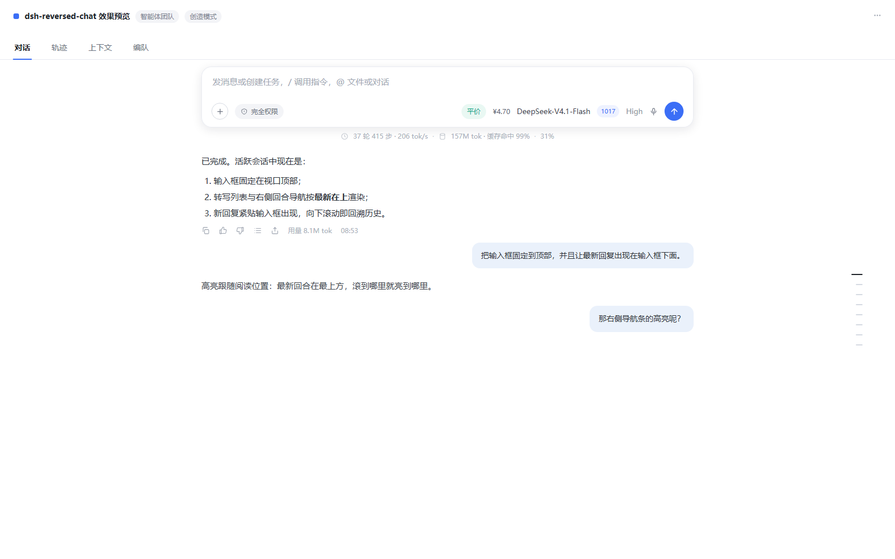
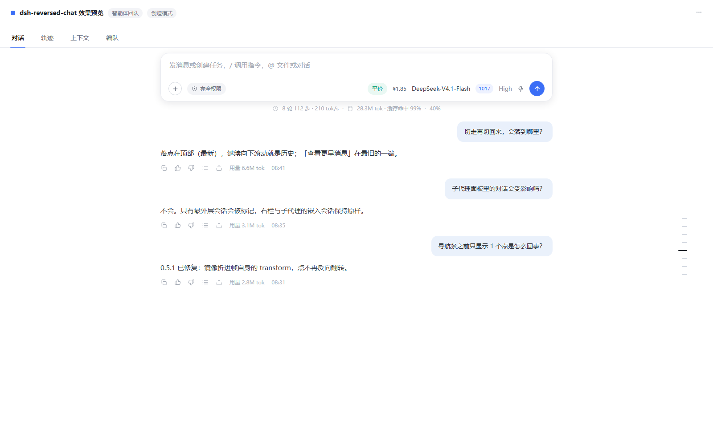

# dsh-reversed-chat

> **0.7.0 更名**：原名 `dsh-composer-top`。旧名只写了「输入框置顶」，新名字覆盖插件做的两件事——「对话栏倒序阅读」+「输入框置顶」。内部包名 / Loader id / 开关属性（`data-dsh-reversed-chat`）同步更名，功能不变。

自实现的极简 DSH 客户端插件（参考 `dsh-layout-control` 的思路）。为「程序员职业病（颈椎）」定制阅读布局：

1. **输入框**：新对话时居中（hero 相，原样）；对话开始后（active 相）固定在会话视口顶部（替代默认贴底）。
2. **倒序阅读（0.2 新增）**：转写列表最新一轮渲染在最上方（紧贴输入框）——模型的每次新回复都出现在你正在看的地方；向下滚动即回溯历史。
3. **Turn 导航条倒序（0.3 新增）**：右侧圆点导航条同样最新在最上，与转写阅读方向一致；点击跳转、悬停预览、居中跟随全部照常。

## 效果预览



- **活跃会话**：输入框固定在视口顶部，最新一轮对话紧贴输入框出现；向下滚动即回溯历史。
- **右侧回合导航条**：最新回合在最上方，实心长条跟随阅读位置。



> 截图为演示界面（离线渲染，演示内容为虚构对话），实际效果以运行中的 DSH 为准。

## 原理

宿主用相属性控制输入框位置（`@deepseek-ai/dsh-client-ui-conversation` / `ConversationRoot.module.css`）：

- `hero` → `justify-content: center` → 居中（不碰）
- `active` → `[data-composer-seat] { position: sticky; bottom: 0 }` → 贴底（覆盖为贴顶）

`apply(ctx)` 做六件事：

1. `<html>` 打开关属性 `data-dsh-reversed-chat`（停用即消失，布局零残留）；
2. 注入一张样式表，只用稳定锚点（`[data-content-phase]` / `[data-composer-seat]` / `[data-slot=…]` / `[data-chat-flow]`，不碰 CSS Module 哈希类名）；
3. 400ms 轮询给「最外层会话」滚动口打 `data-dsh-top-main` 标记 —— 子代理面板、右栏会话等嵌入对话永不误伤；
4. 同一轮询按结构给库存「回到底部」槽打 `data-dsh-to-bottom-slot` 标记并隐藏（唯一子元素是纯图标 `<button>` 的浮动容器，且有 flow/composer/nav/tooltip 四道排除）——该槽在库存 DOM 里没有稳定属性、只有哈希类名，所以这里用结构识别而不是 `[class*=…]`；DOM 若变化，最坏结果是该按钮重新出现（纯装饰）；
5. 在主滚动口元素实例上遮蔽 `scrollTop` / `scrollTo`：宿主所有「跳到底部（最新）」的写入（打开会话、跟随流式输出）目标是 `metrics.floor`（最大滚动值），一律改写为跳到顶部（倒序后最新在 `scrollTop 0`）。其余程序化滚动（导航条跳转、锚点恢复）按几何原样放行。
6. 同一轮询维护导航条「当前回合」的几何补偿：在宿主的阅读线探测（`readVisibleTurn`）执行期间遮蔽 flow 行的 `getBoundingClientRect`，让倒序布局下探测落在阅读线所在回合（默认最新），详见「0.6.0 修复」。

### 倒序为什么安全

- 转写**不是**虚拟化渲染（`@tanstack/react-virtual` 只用于右侧 turn 导航条）；flow 项就是 `[data-slot="conversation.chat.flow"]` 的直接子元素，`flex-direction: column-reverse` 只翻转视觉顺序，DOM 顺序与宿主全部测量逻辑原样。
- 新回复在 DOM 末尾追加 → 视觉上出现在容器顶部（输入框下方）→ 视口钉在 `scrollTop 0` 即时可见，`overflow-anchor: none` 防止滚动锚定把阅读位置拖走。
- 「查看更早消息」按钮翻到最旧一端（底部），语义不变。

### 导航条倒序为什么安全（0.3，0.5.1 修正镜像方式）

导航条是 TanStack 虚拟化的点列表（`transform` 定位），不能动它的滚动数学，所以在 `nav.frame` 级做整帧**镜像**：`transform: translateY(-50%) scaleY(-1)` —— 库存的 `translateY(-50%)`（居中）留在镜像**外层**，帧的位置分毫不动；点、悬停浮泡随帧一起镜像。稳定锚点：`nav:has(button[data-index])`、`[role="tooltip"]`，零哈希类名。

**两个坑（0.5.1 修复）**：CSS `scale` 属性是独立变换，组合在 `transform` **之后**，所以

- 用 `scale: 1 -1` 直接镜像帧时，帧自己的 `translateY(-50%)` 也被翻转 → 整帧下沉自身高度（最多 420px，半截出屏）；
- 再对每个点 `button[data-index] { scale: 1 -1 }` 时，点的定位就是它自己的行内 `transform: translate3d(0, start, 0)`，被翻转后每个点落到槽位的镜像一侧（滚动口的 `overflow` 裁剪之外）→ 12 个回合的画面里只剩 1 个点可见，即「用户发了多条对话，导航条只有 1 个跳转点」。

现在的做法：帧用 `transform: translateY(-50%) scaleY(-1)` 镜像；点**不做**反向翻转（点的字形是 20×2 的水平条 `.mark::before`，上下对称，本来不需要翻正）；只有浮泡里的文字子元素反向翻转保持可读（两行上下次序对调，纯装饰取舍）。

### 输入框置顶的视觉细节（0.7.1）

置顶后卡片若直接贴着 tab 栏下沿，会同时有两个观感问题：**太挤**，以及卡片自带的柔和阴影（`--dsw-elevation-soft`）被滚动口在顶部裁掉，看起来像“贴边”。0.7.1 的处理：

- **顶部留白 12px**：sticky 座位加 `padding-top`，卡片浮在横线下方，阴影有呼吸空间；留白区用页面底色（`--dsw-alias-bg-base`）铺满，转写内容不会从缝里透出来；
- **底部渐隐 20px**：座位底部内边距 + 背景渐变到透明，向下滚动的内容在卡片下沿柔和淡出，而不是硬切；不滚动时该区域就是页面底色，无副作用；
- 三个尺寸都是 CSS 变量，可直接覆盖微调：`--dsh-reversed-chat-top-gap`（默认 12px）、`--dsh-reversed-chat-bottom-gap`（8px）、`--dsh-reversed-chat-fade`（20px）。

只在 `active` 相生效；`hero`（新对话居中）与 `settling`（切换过渡）保持库存行为。

## 文件

```
package.json       dsh.client 声明（platform web, inject []）+ dsh.bundle.patch 声明
                   + locale / icon 的 exports（管理器显示元数据）
cordis.patch.yml   - insert: 一条 Loader 条目 → 管理器列表/开关的数据源（唯一插入处）
locale/en.json     英文显示元数据：meta.title / meta.description
locale/zh.json     中文显示元数据
icon.svg           插件图标（exports["./icon"]，≤256 KiB）
lib/index.js       宿主半边占位（空 apply，供 Loader 条目挂载）
lib/client.js      浏览器半边：window.__ModuleLoader__.load({ id, factory })，导出 { inject, apply }
```

### 为什么需要 cordis.patch.yml（插件管理器可见性）

插件管理器的列表读的是 **Loader（cordis 加载树）条目**（`dsh-host-plugin-inventory` 的 `readPluginInventory()` 遍历 `ctx.loader.entries()`），而 `dsh.client` 声明只驱动**客户端扫描器**加载 `lib/client.js` —— 两条通道互不相干。没有 `- insert` 行 = 功能生效但管理器里没有名字和开关。`dsh.bundle.patch` 声明让 `dsh plugin add` 在安装时自动应用该补丁。

**insert 只能存在一处。** bundle 通道下（`dsh.profile.bundles` 含本包）这一行由插件自带的 `cordis.patch.yml` 提供；profile 的 `cordis.patch.yml` 只允许写 id 覆盖行（例如默认关的 `disabled: true`）。若 profile 再镜像一条同样的 `insert`，合成结果会出现**两行同 id**：管理器的 `listPlugins()` 找不到"唯一"补丁行，该行变成只读（界面提示「当前 profile 的 patch 无法唯一定位这一项」），开关失效；同时 Loader 按 id 后写覆盖，默认开关状态还会随两行先后顺序翻转（disable 行在 insert 之前就会变成默认开启）。`dsh-better-sidebar` 的 bundle patch 注释里也警告过 manual mount line 必须删除。

## 安装 / 更新

**从 npm 安装（推荐）**

```bat
dsh plugin --profile desktop add "dsh-reversed-chat"
```

**从 GitHub 安装（公开仓库）**

```bat
dsh plugin --profile desktop add "github:lingr7/dsh-reversed-chat"
```

**本地开发（link 安装）**

先**完全退出 DSH**，然后：

```bat
:: 首次
dsh plugin --profile desktop add "link:<plugin-dir>"
:: 更新（link 安装指向本目录，拉新代码后重启 DSH 即可；若被复制安装则先 remove 再 add）
```

启动 DSH → Ctrl+F5 → 验收：

0. **启用状态由开关决定（0.4 起）**：本机 profile 补丁层带 `disabled: true` 覆盖行 → 默认不生效；到「插件管理」打开 `dsh-reversed-chat`，然后 **Ctrl+F5**，以下效果才出现。开关切换后都需要 Ctrl+F5（客户端模块在页面启动时装配）。该覆盖行就是 profile 层**唯一**允许的条目，**不要**再写 `insert`（见上一节）；
1. 新建对话：输入框居中；
2. 发送消息：输入框固定顶部，**回复内容出现在顶部**（紧贴输入框），旧内容被推向下方；
3. 向下滚动读历史（越往下越旧），「查看更早消息」在底部；
4. 切走再切回会话：落点在顶部（最新）；
5. 右侧 turn 导航条：**点的数量 = 会话回合数**（来自 `turnOutline` 投影，与已加载窗口无关；0.5.1 修），**最新回合的点在最上**，点击跳转正确，悬停预览跟随点位且文字可读；
6. 右栏 / 子代理的嵌入会话不受影响。

## Bundle patch 纪律与默认关（0.4 / 0.4.1 / 0.5）

**宿主硬性要求**：「bundle patch 含配置/表达式, 热挂载仅支持纯 insert; 重启后由 bundle 层生效」。因此：

- 插件自带的 `cordis.patch.yml` 永远是**纯 insert**（只有 `id` + `name`，无配置字段、无 `!!js` 表达式）→ `dsh plugin add` 可以热挂载，安装即时生效（启用状态下）；这也是该行**唯一**的插入处；
- **默认状态不属于 bundle patch**：本机「默认关」由 profile 补丁层的 id 覆盖行承载（`- id: dsh-reversed-chat` + `disabled: true`，与 better-sidebar 禁用行同形态）。客户端扫描器跳过被禁用的 Loader 条目（`processOne()` 的 `entry.disabled` 检查），`lib/client.js` 不装配，布局零改动；
- **profile 层只写覆盖行，绝不重复 insert**（0.5 修正）：此前 profile 里镜像了一条 insert，合成出两行同 id，管理器把该行标为 `unaddressable`（「当前 profile 的 patch 无法唯一定位这一项」）而无法开关。排查/修复口径见上一节；
- 管理器开关 = `setPluginEnabled` → `writePluginEnabled` 增删/改写 profile 层的 id 覆盖行并热重载 Loader 条目（`composeEntries` 统一合成有效状态）→ **Ctrl+F5** 后客户端装配清单随之变化；
- 首次开关操作后，状态完全由管理器接管：第一次启用会删掉覆盖行（bundle 层本身就是 enabled），之后再停用会重新追加 `- id: dsh-reversed-chat` + `disabled: true`。

## 0.5.1 修复：导航条只剩一个跳转点

**现象**：会话有多个回合，右侧导航条却只显示 1 个点；回合越多越明显。

**根因**（0.3 引入）：`scale: 1 -1` 是独立变换属性，按规范组合在 `transform` 之后。

1. 帧（`nav.frame`）自己的 `transform: translateY(-50%)` 被翻转 → 帧下沉自身高度；
2. 每个点（`button[data-index]`）的定位就是它自己的行内 `transform: translate3d(0, start, 0)`，被 `scale: 1 -1` 翻转后点落到槽位的镜像一侧，超出滚动口（`.scroller` 的 `overflow-y: auto`）的裁剪范围；结果只有最靠近裁剪边界的那 1 个点可见。DOM 里点一个不少——TanStack 的 `count`/`getVirtualItems` 完全正常，丢的是**渲染位置**。

**修法**：镜像折进帧自己的 `transform`（`translateY(-50%) scaleY(-1)`，居中项留在镜像外层）；点**不再**反向翻转（字形是水平条，对称）；浮泡文字子元素保留反向翻转。只改 2 条 CSS / 1 条 transform，不动虚拟化、不碰点击与滚动数学。

**验证**（Chromium + 真机同款客户端模块，非模拟）：12 回合会话 12 个点全部可见、最新（turn 12）在最上；2 / 6 回合同理；1 回合会话仍不显示导航条（库存 `items.length < 2` 逻辑）；悬停浮泡中心与点位对齐；点击第 7 个点落到 turn 7 与 turn 6 的视觉分界（上方 turn 7、下方 turn 6，符合倒序阅读）。

## 0.6.0 修复：导航条默认高亮最早回合

**现象**：会话有多个回合时，右侧导航条的「当前回合」实心长条（`.markActive`）总是落在**最早**一回合（画面最下方那个点）；倒序阅读下视线所在的是最新回合（最上方），预期应是最新回合实心。

**根因**（宿主 `@deepseek-ai/dsh-client-ui-chat` 的 `readVisibleTurn()`）：宿主用二分查找求「阅读线所在回合」，前提是 **DOM 顺序 = 视觉上下顺序**（`row.getBoundingClientRect().top` 随 DOM 索引单调递增）。`flex-direction: column-reverse` 只翻转视觉顺序、DOM 仍旧→新，于是：

- 行的 `top` 随 DOM 索引**递减**，二分判据方向相反；
- 查找只会往左收，永远够不到 DOM 末尾的最新行，`reading` 保持初值 `turns[0]` —— **最早回合**；
- `activeTurn` 恒为最早回合 → 轨道实心高亮、自动居中跟随（`scrollToIndex(activeIndex)`）、`aria-current` 一起错。

**修法**（不改宿主、不动 DOM 顺序）：只在宿主探测调用期间补偿几何。插件在 flow 行元素实例上遮蔽 `getBoundingClientRect`，用调用栈识别当前是否为 `readVisibleTurn` 在问（栈帧含 `readVisibleTurn`），是则：

- 按宿主同一公式算阅读线：`scrollport.top + min(96, clientHeight * 0.2)`；
- 在真实几何里找阅读线所在行：倒序下 = 行 `top` 不大于阅读线的行里 `top` 最大者；若没有（阅读线在转写之上）取最上面的行；
- 该行及之前的行返回 `top = line - 1`、之后的返回 `top = line + 2` —— 二分查看到单调递增的假顺序，精确落回该行；
- 非探测调用（锚点捕获/恢复、导航条点击跳转、`align()`）一律拿到**原样 rect**，几何跳转分毫不动。

行元素增删由 `MutationObserver` 即时补挂；切换会话时随主滚动口重挂；插件停用时全部还原（删除实例属性，原型行为恢复）。

**验证**：6 回合会话默认最新回合为实心长条、位于导航条最上；向下滚动读史时长条跟随阅读线；点击跳转、悬停预览、导航条居中跟随照常；`aria-current` 同步正确。

## 0.7.2 修复：输入框置顶后 + / 命令弹窗跑到屏幕外

**现象**：插件启用后，点输入框旁的「+」或输入「/」时，候选菜单仍按“向上弹”渲染；输入框在顶部，菜单整个跑到视口上方看不见。

**根因**（宿主 `ui-input-trigger` / `ui-commands`）：菜单是 `position: absolute; bottom: calc(100% + 4px)`，挂在输入卡片顶部一个 0 高度的 `[data-composer-overlay]` 锚点上；`max-height` 也由 `useAnchoredMaxHeight()` 按“菜单上方的可用空间”计算。输入框贴底时向上弹是对的，贴顶后就出界。

**修法**：

- 活跃会话下把该 overlay 锚点移到卡片底部（CSS），菜单改为 `top: calc(100% + 4px)` 向下展开；
- 菜单打开的瞬间（`MutationObserver` 监听 overlay），按卡片真实几何重新定位：距卡片底部 4px、宽度对齐卡片、`max-height` 按视口剩余空间重算（触发菜单上限 400、popup 选择器上限 320），并用 `!important` 压过宿主内联高度；400ms 轮询再校正一次；
- 覆盖两类菜单：`+` / `/` 的候选菜单（`[data-trigger-menu]`）与 `/model`、`/permission` 等选择器（后者没有稳定属性，用“绝对定位 + 底部锚定”的计算样式识别）。

**验证**：启用后点「+」或输入「/」——菜单出现在输入卡片下方、完整可见、内部可滚动；`/model`、`/permission` 等选择器同理；hero 相（新对话）保持库存的向上弹行为。

## 已知取舍（倒序与宿主 JS 假设的偏差）

- 宿主 `readVisibleTurn()` 的二分查找假设「DOM 靠后 = 视觉靠下」：turn 高亮已在 0.6 用「探测期几何补偿」修正（依赖宿主函数名 `readVisibleTurn`；若未来宿主改名/内联导致栈帧缺失，补偿静默失效，回退为 0.5 的「恒最早回合」表现，不会崩溃）。阅读位置捕获/恢复仍按原假设工作，加载更早消息后落点可能轻微偏移。纯体验损耗，不影响功能。
- 库存「回到底部」按钮的可见性/方向逻辑失效，已按结构打标隐藏（`data-dsh-to-bottom-slot`，不依赖哈希类名）；回到最新 = 滚回顶部。若库存 DOM 结构调整导致识别失效，唯一后果是该按钮重新出现（纯装饰）。
- 展开折叠历史后的滚动位置还原不精确（同第一条）。
- 正在运行的「思考中」分隔线的 `nth-last-child` 判定按 DOM 序，反转后出现位置可能不符设计（纯装饰）。
- 导航条：滚动口两端的淡出渐变方向可能对调（纯装饰）；在导航条内滚轮的「向下 = 更旧」手感与视觉移动方向相反（条短时无感）；悬停预览的两行文字（提问/回复）上下次序对调。
- 与 `dsh-layout-control` 的「停靠四角」功能重叠会打架：二选一，或其输入栏保持「完整」。

## 显示元数据与打包（0.5）

- 管理器 / bundle 详情里的标题与说明来自 `locale/<lang>.json` 的 `meta.title` / `meta.description`（本包提供 `locale/en.json`、`locale/zh.json`，经 `exports["./locale/*.json"]` 暴露）；
- 图标来自 `exports["./icon"]` → `icon.svg`（宿主支持 SVG/PNG/JPEG/WebP，≤256 KiB，`data:` 内联后交给界面）；
- `package.json` 的 `files` 必须同时包含 `lib`、`cordis.patch.yml`、`locale/*.json`、`icon.svg`：**漏掉 `cordis.patch.yml` 时打包产物会缺 bundle patch**，`dsh plugin add` 直接失败（本地 `link:` 安装不受影响）；
- 这些元数据只用稳定的 `dsh`/`exports` 约定，不读运行时状态，因此管理器不激活插件也能显示。

## 参考

- `dsh-layout-control`（思路来源：overlay + 稳定锚点 + 属性开关）：`%USERPROFILE%\.dsh\profiles\desktop\node_modules\dsh-layout-control`，[GitHub](https://github.com/LzqSuShi/dsh-layout-control)
- `dsh-better-sidebar`（client 插件写法范本）：[GitHub](https://github.com/omdsh-dev/DSH-better-sidebar)
- 宿主侧代码：asar 内 `dsh/node_modules/@deepseek-ai/dsh-client-ui-chat/lib/client.js`（`ChatView`、`ScrollFollow`、flow slot 注册）与 `dsh-client-ui-conversation/lib/client.js`（`ConversationContent`、`conversationPhase()`）
